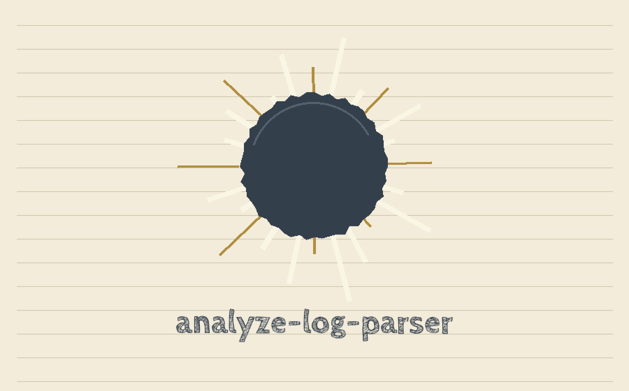

# analyze-log-parser


<p align="center"></p>


A command line tool that parses a plain text log file, counts how many entries have each log level, and writes the counts to a CSV report.


## Requirements

- Python 3
- pandas, listed in `requirements.txt`. The other imports (`argparse`, `logging`, `os`, `sys`) are from the Python standard library.


## Install

```bash
git clone https://github.com/ShadowGuard-AI/analyze-log-parser.git
cd analyze-log-parser
pip install -r requirements.txt
```

There is no package on PyPI for this tool. Run it from the cloned directory as shown below.


## Input format

Each log line is expected to have three fields separated by whitespace:

```text
<Timestamp> <Level> <Message>
```

The message may contain spaces. Blank lines are skipped, and lines with fewer than three fields are padded with empty fields. Lines in any other format, for example timestamps that themselves contain a space, will be split at the first two spaces and will not parse as intended.

Example `app.log`:

```text
2024-01-01 INFO User logged in successfully
2024-01-01 ERROR Failed to connect to database
2024-01-02 INFO User logged out
2024-01-02 WARNING Disk space low
```


> Margin note: a timestamp that itself contains a space will be split at the first two spaces and will not parse as intended.


## Usage

```bash
python3 main.py app.log --output report.csv
```

This prints `Analysis report saved to: report.csv`, and `report.csv` contains:

```text
Log Level,Count
INFO,2
ERROR,1
WARNING,1
```

Optional pattern filter, which keeps only lines containing the given string before counting:

```bash
python3 main.py app.log --output errors.csv --pattern ERROR
```


## Parameters

- `logfile` (positional, required): path to the log file to analyze.
- `--output`: path for the CSV report. Default is `report.csv`.
- `--pattern`: optional string. Only lines containing it are counted. Default is empty, which counts every line.
- `-h`, `--help`: show help and exit.

Note: this tool has no `-d` or `--delimiter` option and no short `-o` option, despite what earlier versions of this README said.


> Margin note: this tool has no -d or --delimiter option and no short -o option, despite what earlier versions of this README said.


## Behavior and limitations

- The report has two columns, `Log Level` and `Count`, with one row per distinct level value found in the second field of each line.
- An empty log file, or a pattern that matches nothing, produces a report containing only the header row.
- A missing log file logs `File not found: Log file '<path>' does not exist.` and exits with status 1. Other processing failures also exit with status 1.
- There are no bundled tests. The examples above were verified by hand.


## License

GNU General Public License v3.0. See [LICENSE](LICENSE).
Copyright (C) 2023 CY83R-3X71NC710N

> Margin note: a missing log file logs `File not found: Log file '<path>' does not exist.` and exits with status 1.
